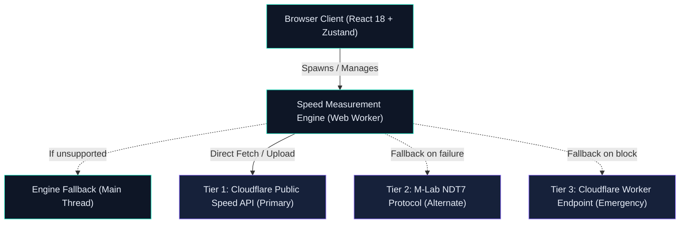

# ⚡ YamkSpeed (Nabd Speed / نبض)

> **Modern, ad-free, bilingual internet speed test web application running 100% client-side with zero backend infrastructure.**
>
> **تطبيق ويب حديث لقياس سرعة الإنترنت، ثنائي اللغة (عربي/إنجليزي)، خالي تماماً من الإعلانات ويعمل بالكامل من جانب العميل بدون خوادم خاصة.**

---

[](LICENSE)
[](https://react.dev/)
[](https://vitejs.dev/)
[](https://www.typescriptlang.org/)
[](https://tailwindcss.com/)
[](https://zustand-demo.pmnd.rs/)
[](https://vercel.com/)
[](#accessibility)
[](#internationalization-i18n--rtl)

---

## 📖 Overview | نظرة عامة

**YamkSpeed** (المعروف أيضاً بالاسم الرمزي **نبض / Nabd Speed**) هو تطبيق ويب مفتوح المصدر ومستقل صُمم لتقديم قياس دقيق، موثوق، وعادل لسرعة الاتصال بالإنترنت (التحميل، الرفع، زمن الاستجابة، وتقلب الإشارة/Jitter).

على عكس معظم أدوات قياس السرعة التقليدية المثقلة بالإعلانات التجارية، وأكواد التتبع المشبوهة، والبيانات التخمينية المحاكاة، يعمل **YamkSpeed** مباشرة من متصفح المستخدم إلى شبكات القياس العالمية الموثوقة، مع احترام صارم لخصوصية المستخدم واستهلاك البيانات.

### 🌟 Why YamkSpeed? | لماذا هذا المشروع؟
- 🛡️ **Zero Tracking, Zero Ads**: لا تتبع، لا تحليلات خفية، ولا نوافذ إعلانية.
- ⚡ **Zero Backend Overhead**: يعمل بالكامل كـ Static Single Page App (SPA) على Vercel بنطاق استضافة مجاني دائم دون استهلاك باقات الخادم.
- 🎯 **No Fake Numbers Policy**: جميع البيانات ناتجة عن حركة شبكية حقيقية عبر المتصفح. يُمنع منعاً باتاً محاكاة أو توليد أرقام وهمية (`Math.random` محظور في محرك الفحص).
- 🌍 **Native Bilingual & RTL First**: دعم أصيل للغة العربية من اليمين لليسار (RTL) والإنجليزية (LTR) مع مراعاة العزل الاتجاهي للأرقام والمصطلحات.
- 📊 **3-Tier Engine Resilience**: محرك فحص مرن يعتمد هيكلية ثلاثية بديلة (Cloudflare Edge ➔ M-Lab NDT7 ➔ Cloudflare Worker).

---

## ✨ Key Features | أبرز الميزات

| الميزة | التفاصيل التقنية |
|---|---|
| **قياس متكامل رباعي المحاور** | فحص دقيق لـ: سرعة التنزيل (Download Mbps)، سرعة الرفع (Upload Mbps)، زمن الاستجابة (Latency/Ping ms)، وتشتت الإشارة (Jitter ms). |
| **واجهة "Aurora Pulse" الحيوية** | عداد دائري تفاعلي (270° SVG Gauge) مع خط متوهج وانسيابية عالية بمعدل تحديث مستمر (≥ 4 Hz). |
| **محرك فحص متعدد المسارات (Multi-Stream)** | تشغيل متعدد متكيف للمسارات باستخدام `fetch()` و `ReadableStream` داخل Web Worker مع دعم fallback للـ Main Thread. |
| **حماية الاستهلاك المحدود للبيانات** | وضع قياس خفيف (Light Test Mode) يستهلك ≤ 10 MB للشبكات الخلوية، وبحد أقصى ≤ 50 MB للفحص العادي. |
| **سجل النتائج المحلي (Local History)** | حفظ آمن للنتائج السابقة في المتصفح محلياً عبر `localStorage` مع آلية ترحيل للنسخ وحماية التخزين الخاص (Private Mode Safe). |
| **بطاقة مشاركة ذكية (Share Card)** | تصدير النتيجة كصورة مجهزة للنشر متوافقة مع النصوص العربية والأرقام دون تشويه. |
| **حماية الخوادم والحد من الإساءة (Rate Limiting)** | فترة تبريد إجبارية 30 ثانية بين الفحوصات، حد أقصى 20 فحص/ساعة، ومنع الفحص المتزامن في عدة علامات تبويب (Multi-Tab Mutex). |
| **تطبيق ويب تقدمي (PWA)** | جاهز للتثبيت على الهواتف وأجهزة سطح المكتب مع إمكانية الفتح في وضع دون اتصال. |

---

## 🏗️ Architecture & Technology Stack | المعمارية والتقنيات



### 🛠️ Core Technologies

- **UI Framework**: React 18 + TypeScript + Vite.
- **Styling**: Tailwind CSS v4 + نظام متغيرات التصميم (CSS Tokens) مع خصائص منطقية كاملة (`ms-*`, `ps-*`, `start-*`).
- **Typography**: 
  - العربية: **IBM Plex Sans Arabic** (أرقام متناسقة ومظهر عصري).
  - الإنجليزية: **Space Grotesk** (أرقام جدولية مصفوفة `tabular-nums`).
- **State Management**: **Zustand** (خفيف وسريع لمعالجة حالة الفحص وتحديثات العداد اللحظية).
- **Measurement Engine**: Modular TypeScript Engine، يعمل داخل Web Worker لضمان عدم تجميد واجهة المستخدم أثناء ذروة نقل البيانات.
- **Testing**: **Vitest** (لاختبارات المحرك الرياضية والوحدات) + **Playwright** (لاختبارات E2E وسلوك المتصفح).
- **Deployment & Security**: Vercel Static Hosting مع ترويسات أمنية صارمة (`Content-Security-Policy`, `HSTS`, `Permissions-Policy`).

---

## 📚 Documentation Index | فهرس التوثيق والمواصفات

تم إعداد ملفات دراسة تحليلية وهندسية شاملة تغطي كل جانب من جوانب النظام. يمكنك مراجعة الملفات في مجلد [`docs/`](file:///c:/yamk-speed/docs/):

| # | الوثيقة | الوصف والغرض |
|---|---|---|
| **00** | [00-README.md](file:///c:/yamk-speed/docs/00-README.md) | دليل حزمة التخطيط السريع وملخص القرارات المعمارية الرئيسية. |
| **01** | [01-study-requirements-analysis.md](file:///c:/yamk-speed/docs/01-study-requirements-analysis.md) | دراسة المتطلبات، قيود الاستضافة، تحليل المخاطر (R1-R11) وجدوى الاعتماد على الخدمات العامة. |
| **02** | [02-study-technology-selection.md](file:///c:/yamk-speed/docs/02-study-technology-selection.md) | مقارنة التقنيات وقرارات التصميم المعماري (ADR-001 إلى ADR-008) وترويسات CSP. |
| **03** | [03-study-measurement-methodology.md](file:///c:/yamk-speed/docs/03-study-measurement-methodology.md) | منهجية القياس الرياضية، فترات الإحماء، حساب الـ Jitter، ومنع تزييف البيانات. |
| **04** | [04-study-design-i18n-theming.md](file:///c:/yamk-speed/docs/04-study-design-i18n-theming.md) | الهوية البصرية "Aurora Pulse"، لوحة الألوان، قواعد التعريب (RTL)، والخطوط العربية. |
| **05** | [05-PRD.md](file:///c:/yamk-speed/docs/05-PRD.md) | وثيقة متطلبات المنتج الكاملة (PRD)، قصص المستخدم، والمتطلبات الوظيفية وغير الوظيفية. |
| **P1** | [phase-1-foundation.md](file:///c:/yamk-speed/docs/phase-1-foundation.md) | خطة المرحلة 1: التأسيس التقني، إعداد المشروع، نظام التصميم، والتأكد من إمكانية الاتصال (Spike). |
| **P2** | [phase-2-measurement-engine.md](file:///c:/yamk-speed/docs/phase-2-measurement-engine.md) | خطة المرحلة 2: بناء محرك القياس الأساسي، فحص التنزيل والرفع، والتحقق الرياضي. |
| **P3** | [phase-3-ui-experience.md](file:///c:/yamk-speed/docs/phase-3-ui-experience.md) | خطة المرحلة 3: بناء العداد التفاعلي (SVG Gauge)، تدفق الحركة، ودعم شاشات الهواتف. |
| **P4** | [phase-4-features-resilience.md](file:///c:/yamk-speed/docs/phase-4-features-resilience.md) | خطة المرحلة 4: ميزات إضافية (سجل النتائج، التصدير كصورة، وضع البيانات الخفيف، PWA). |
| **P5** | [phase-5-qa-launch.md](file:///c:/yamk-speed/docs/phase-5-qa-launch.md) | خطة المرحلة 5: ضبط الجودة، اختبار الأجهزة الحقيقية، التدقيق الأمني، والإطلاق النهائي. |

---

## 📁 Project Directory Structure | هيكل المشروع المقترح

```text
yamk-speed/
├── docs/                             # وثائق المشروع والدراسات الهندسية
│   ├── 00-README.md
│   ├── 01-study-requirements-analysis.md
│   ├── 02-study-technology-selection.md
│   ├── 03-study-measurement-methodology.md
│   ├── 04-study-design-i18n-theming.md
│   ├── 05-PRD.md
│   └── phase-[1-5]-*.md
├── public/                           # الملفات الثابتة، الأيقونات، وبيان PWA
│   ├── favicon.svg
│   ├── manifest.json
│   └── icons/
├── src/
│   ├── assets/                       # الخطوط والرسومات الثابتة
│   ├── components/                   # مكونات واجهة المستخدم
│   │   ├── Gauge/                    # عداد السرعة الدائري
│   │   ├── Results/                  # شبكة عرض النتائج
│   │   ├── History/                  # سجل الفحوصات والرسوم البيانية
│   │   └── Layout/                   # الشريط العلوي وتغيير اللغة/المظهر
│   ├── engine/                       # محرك القياس النقي
│   │   ├── worker.ts                 # Web Worker المخصص للفحص
│   │   ├── cloudflare.ts             # محول خوادم Cloudflare
│   │   ├── mlab.ts                   # محول خوادم M-Lab
│   │   ├── math.ts                   # خوارزميات حساب السرعة والـ Jitter
│   │   └── types.ts                  # تعريفات الأنواع الرياضية والنتائج
│   ├── i18n/                         # نظام الترجمة وثنائية اللغة (AR / EN)
│   │   ├── ar.ts
│   │   ├── en.ts
│   │   └── useI18n.ts
│   ├── stores/                       # مخازن الحالة (Zustand)
│   ├── styles/                       # متغيرات التصميم وقواعد الألوان
│   ├── App.tsx                       # المكون الرئيسي
│   └── main.tsx                      # نقطة الدخول
├── tests/                            # اختبارات الوحدات والـ E2E
├── vercel.json                       # ترويسات الأمان وإعدادات النشر على Vercel
├── package.json
└── README.md
```

---

## 🚀 Getting Started | البدء والتطوير المحلي

### المتطلبات الأساسية
- **Node.js**: الإصدار `20.x` أو أحدث.
- **مدير الحزم**: `npm` أو `pnpm`.

### التثبيت والتشغيل

1. **استنساخ المستودع (Clone Repository):**
   ```bash
   git clone https://github.com/yamksoft/yamk-speed.git
   cd yamk-speed
   ```

2. **تثبيت الاعتماديات (Install Dependencies):**
   ```bash
   npm install
   ```

3. **تشغيل بيئة التطوير (Run Dev Server):**
   ```bash
   npm run dev
   ```
   سيتم تشغيل الخادم المحلي على الرابط: `http://localhost:5173`.

4. **تشغيل الاختبارات (Run Tests):**
   ```bash
   # اختبارات الوحدات الرياضية ومحرك الفحص
   npm run test

   # اختبارات التصفح والتكامل (E2E)
   npm run test:e2e
   ```

5. **بناء الحزمة للإنتاج (Production Build):**
   ```bash
   npm run build
   ```

---

## 🧭 Roadmap & Implementation Phases | خارطة الطريق

- [ ] **المرحلة 1: التأسيس التقني (Phase 1 — Foundation)**: إعداد البيئة، اختبار الاتصال بالخوادم، نظام التصميم الداكن والفاتح، وثنائية اللغة.
- [ ] **المرحلة 2: محرك القياس (Phase 2 — Measurement Engine)**: خوارزميات قياس التنزيل والرفع والـ Jitter عبر Web Worker، واختبارات الدقة.
- [ ] **المرحلة 3: تجربة المستخدم والعداد (Phase 3 — UI Experience)**: برمجة العداد الـ SVG المتوهج، الانتقالات الحركية، وملاءمة الهواتف.
- [ ] **المرحلة 4: الميزات المتقدمة والمتانة (Phase 4 — Features & Resilience)**: السجل المحلي، بطاقة المشاركة، وضع التوفير، وتطبيق PWA.
- [ ] **المرحلة 5: ضمان الجودة والإطلاق (Phase 5 — QA & Launch)**: الفحص عبر أجهزة فعلية، إمكانية الوصول (A11y)، التدقيق الأمني، والنشر عبر Vercel.

---

## 🔒 Security & Privacy Policy | الأمان والخصوصية

- **سياسة المحتوى الصارمة (Strict CSP)**: تقييد كافة الاتصالات بمصادر الفحص المعتمدة فقط (`cloudflare.com`, `m-lab.net`).
- **حماية بيانات المستخدم**: لا يتم جمع أو إرسال أي عناوين IP أو سجلات شخصية إلى خوادم خارجية؛ كافة السجلات تظل مخزنة في متصفح المستخدم فقط.
- **منع إساءة الاستخدام**: تطبيق آليات كبح الطلبات لمنع إغراق الخوادم العامة بالطلبات المتكررة.

---

## 📄 License | الترخيص

هذا المشروع مرخص تحت رخصة **MIT**. راجع ملف [LICENSE](LICENSE) لمزيد من التفاصيل.

---

<div align="center">
  <sub>صُمم وطُوّر بكل فخر بواسطة <a href="https://github.com/yamksoft">yamksoft</a> • Designed with precision for honest internet benchmarking.</sub>
</div>
